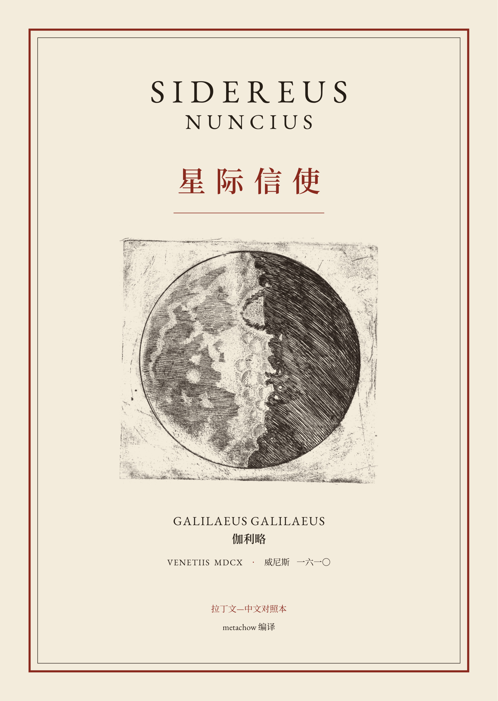
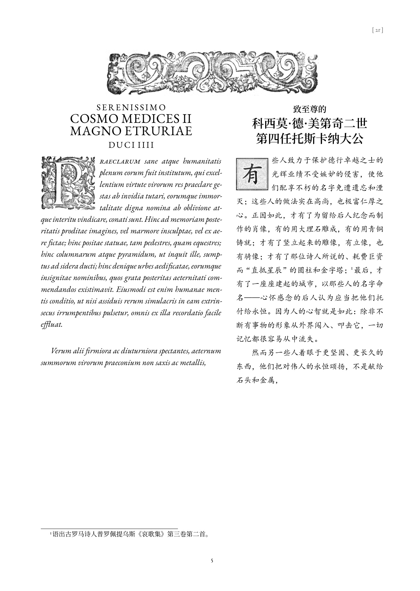
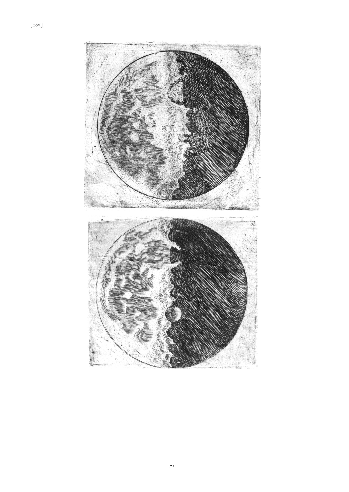
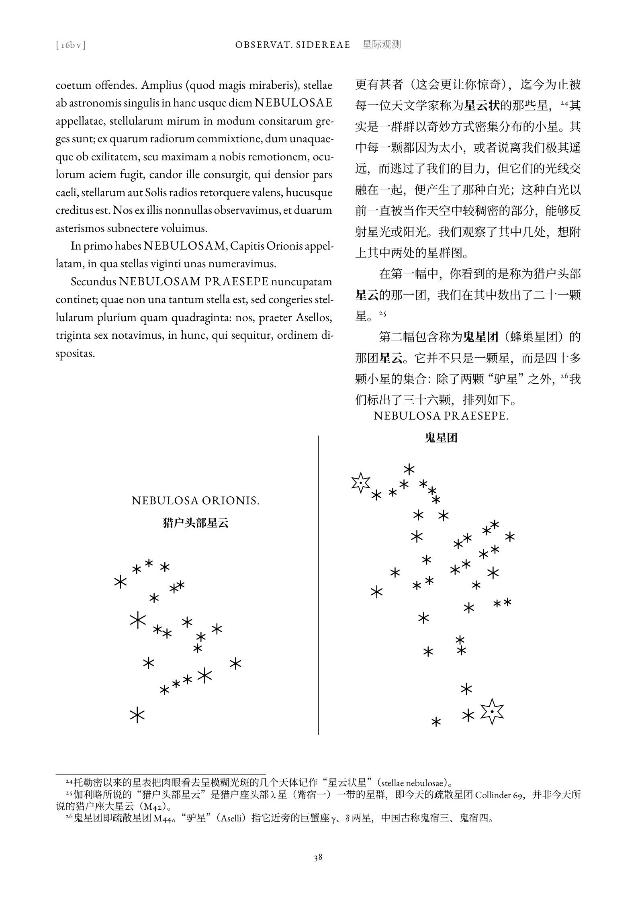
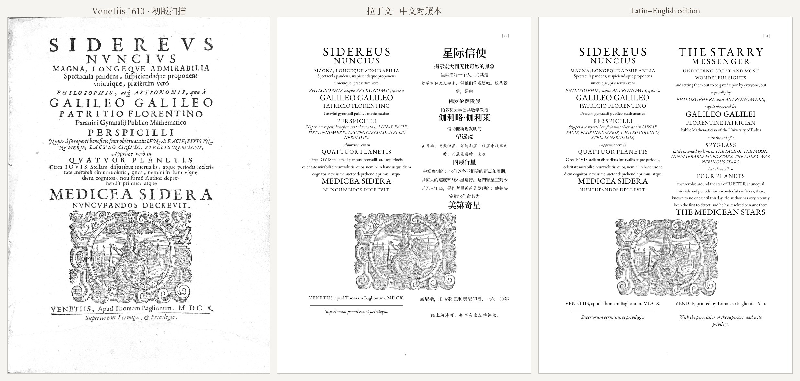
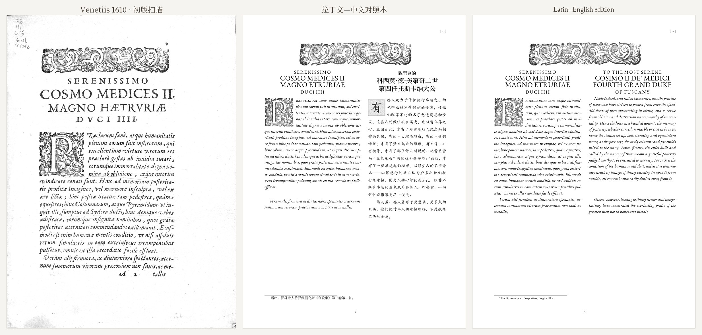
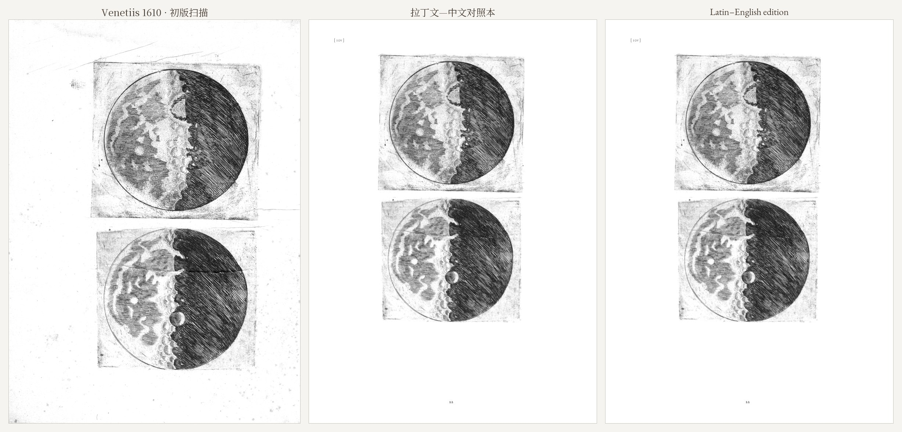
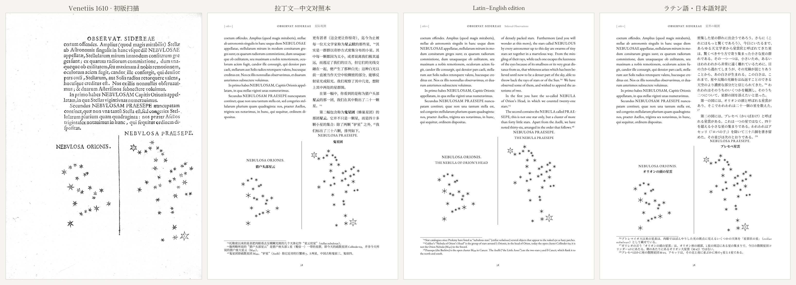
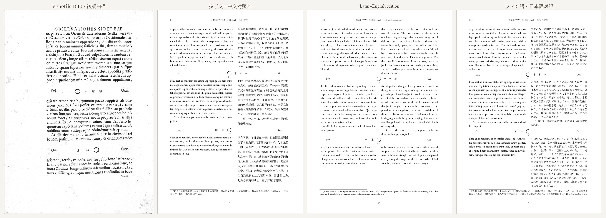
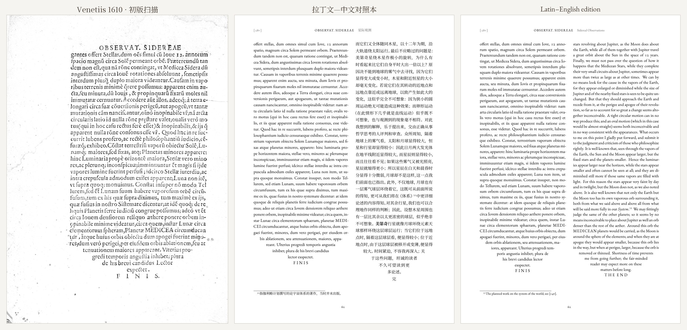

# 星际信使 · Sidereus Nuncius（1610）重排对照本

伽利略《星际信使》（威尼斯，1610）的重排对照本，现有三个版本：

- **拉丁文—中文对照本**：左栏现代拼写的拉丁文，右栏直接译自拉丁文的中文；
- **Latin–English parallel edition**：同一拉丁文，右栏为直接译自拉丁文的新英译；
- **ラテン語・日本語対訳『星界の使者』**：同一拉丁文，右栏为直接译自拉丁文的新日译。

三个版本都用 XeLaTeX 排版，**每页对应 1610 年初版的一页**：页眉、断页、字体分工照初版；木星卫星图、星图、几何示意图按初版逐点测量重绘为矢量图；月面铜版画、木刻首字母、花饰与印刷商标取自初版扫描，经去黄和折痕修补。英译在初版断页的位置断开；中文和日文语序不同，在最接近的分句处断开。

*A re-typeset edition of Galileo's* Sidereus Nuncius *(Venice, 1610), page for page with the first edition: modernised Latin beside a new Chinese, English or Japanese translation made directly from the Latin, with the original's type roles, redrawn figures and restored engravings.*

成书 PDF 见 [Releases](../../releases)。制作过程见博客：[把一本 1610 年的书重新排一遍](https://metachow.github.io/post/sidereus-nuncius/) · [Re-typesetting a book from 1610](https://metachow.github.io/post/sidereus-nuncius-en/)。

<p align="center">
  
  
  
  
</p>

## 原版与重排版对照

左起：1610 年初版扫描（去黄后）、拉丁文—中文对照本、Latin–English edition、ラテン語・日本語対訳。四者是同一页，拉丁文的起止完全相同。

**书名页 [1r]**：初版的四级大写、带花式大写的斜体说明句和印刷商标，逐行照排。


**献词首页 [2r]**：初版整段斜体；花饰带、两级标题和木刻首字母 P 取自扫描，中文用楷体、日文用教科书体，配新制的木刻风格首字。


**月面铜版画 [10v]**：取自扫描，经去黄和折痕修补，按初版原尺寸排入。


**星图 [16b v]**：猎户头部星云与鬼星团，按扫描逐星测量后重绘，星数与伽利略正文一致。


**木星卫星观测 [17v]**：1610 年 1 月 8 日、10 日的记录，木星图按初版坐标重绘。


**结尾 [28v]**：初版以倒三角收尾，各栏照排，尖端居中。


## 构建

需要 TeX Live（XeLaTeX、ctex、paracol、lettrine、tikz）和 Python 3（Pillow、numpy、scipy、PyMuPDF、fontTools、PyYAML）。

```bash
python tools/make_fonts.py --ja         # 从 Noto Serif SC / JP 可变字体导出三档静态字重到 fonts/
python tools/build_book.py              # 中文版：由 text/ 生成 folia/，编译并检查 -> main.pdf
python tools/build_book.py --lang en    # 英语版：生成 folia_en/，编译并检查 -> main_en.pdf
python tools/build_book.py --lang ja    # 日语版：生成 folia_ja/，编译并检查 -> main_ja.pdf
```

`build_book.py` 编译两遍，检查左右页（初版的正面必须落在右页）、LaTeX 错误和超宽行。只改某一页时：`python tools/gen_folia.py [--lang en --out folia_en]`，再 `python tools/check_folio.py [--lang en] f17v`，检查这一页是否正好排满一页并生成预览图。

楷体（献词、斜体对应）用的是 Windows 自带的 KaiTi，日语版对应的教科书体用 Windows 自带的 UD Digi Kyokasho；在其他系统上请在 `preamble.tex` 里把 `zhkai` 换成本机的楷体或教科书体字体。扫描图不在仓库里，需要时运行 `python tools/fetch_scans.py` 下载并去黄（约 400 MB）；`python tools/make_comparison.py f17v` 生成上面的对照图。

## 文本与版面的组织

文字的唯一来源是 `text/`，页面文件由脚本生成，不要手改：

| 文件 | 内容 |
|---|---|
| `text/la.yaml` | 拉丁文：81 段、315 句，按段落和句子编号（如 `p032.01`）；`⟦8v⟧` 标出初版断页，`⟦\|⟧` 标出同一页内的对齐块分界（多在插图处） |
| `text/zh.yaml` | 中文：按对齐块存放，与拉丁文的块一一对应 |
| `text/en/part1–5.yaml` | 英语：按句存放，键与拉丁文相同；跨页的句子带同样的断页标记，生成时在那里切开 |
| `text/ja/part1–5.yaml` | 日语：按句存放，键与拉丁文相同；跨页的句子在最接近的分句处带断页标记 |
| `text/layout.yaml` | 每一叶的结构：页面样式、对齐块、插图和特殊排版块的顺序；个别排得满的页在此微调字号行距（`tr_size`、`la_size`） |

改拉丁文改 `la.yaml`，改译文改 `zh.yaml`、`en/` 或 `ja/`，改插图位置和特殊排版改 `layout.yaml`，然后重新编译。

### 增加其他语言的译文

按句翻译即可，不必考虑分页：在 `text/<语言>/` 下为 `la.yaml` 的每一句写一条译文（键如 `p012.03`），特殊排版块（书名页、标题、签名）按块翻译（键如 `f04v.3`）。工具：

- `tools/show_range.py p015 p022 [--en]`：列出某段范围的拉丁文、中文版（及英语版）对应文字和特殊块，供译者使用；
- `tools/check_translation.py en text/en/part2.yaml p015 p022`：检查完整性、LaTeX 和编译；
- `tools/list_breaks.py en`：列出 48 个跨页句子及断页标记情况（语序接近拉丁文的语言可以按原文断页，否则整句放在其开头所在的页）；
- `tools/fit_pages.py --lang en f15r`：溢出的页逐档微调该页字号行距，直到排满一页；
- `tools/test_distribution.py`：检查按句分配是否每句恰好出现一次、位置正确。

英语版、日语版的翻译规范与术语表见 `work/EN_TRANSLATION.md`、`work/JA_TRANSLATION.md`；日语版校对时的统一裁定见 `work/review/JA_RULINGS.md`。

## 目录

| 路径 | 内容 |
|---|---|
| `main.tex`、`main_en.tex`、`main_ja.tex`、`preamble.tex` | 三个版本的总控文件与共用导言区（版式、字体分工、木星图与星图宏、倒三角收尾） |
| `front/` | 封面封底、书名页与编辑说明（中文版、英语版、日语版） |
| `text/` | 文字与版面的唯一来源（见上） |
| `folia/`、`folia_en/`、`folia_ja/` | 生成的页面文件，每个文件是初版的一页（如 `f08v` = 第 8 叶背面），不进版本库 |
| `figures/` | 插图；来源、裁切坐标与生成命令见 `figures/README.md` |
| `tools/` | 扫描去黄、木星图测量、星图提取、折痕修补、木刻首字生成、页面生成、试排与检查等脚本 |
| `showcase/` | README 用的预览图与对照图 |
| `work/` | 编辑规范、编辑决定、叶码对照表、拉丁文底本、各阶段的翻译与校对记录 |

## 来源

- **拉丁文**：A. Favaro 编《伽利略全集》国家版第三卷（1892），录自拉丁文维基文库；与 1610 年初版逐页核对，按现代拼写转写。
- **扫描**：Smithsonian Libraries 藏 1610 年威尼斯初版，Internet Archive 条目 [`Sidereusnuncius00Gali`](https://archive.org/details/Sidereusnuncius00Gali)（Not in copyright）。
- **字体**：EB Garamond、Noto Serif SC、Noto Serif JP（均为 SIL Open Font License）。

## 署名

编译：[metachow](https://github.com/metachow)
协作：Claude（Anthropic），参与翻译、校对、排版与插图处理。

中文、英语和日语译文都由 AI 协作完成，直接译自拉丁文，未参照受版权保护的现代译本；尚未经拉丁文专家审校，发现错误欢迎提 issue 或 PR。

## 许可

| 内容 | 许可 |
|---|---|
| 中文、英语与日语译文、注释、编辑说明、LaTeX 排版源码、`text/` 中的数据、重绘的矢量插图 | [CC BY 4.0](LICENSE)，使用时请署名 metachow 并注明出处 |
| `tools/` 中的脚本 | [MIT](tools/LICENSE) |
| 拉丁原文、1610 年初版扫描及取自扫描的铜版画与木刻 | 公有领域 |
| EB Garamond、Noto Serif SC、Noto Serif JP 字体 | SIL Open Font License（字体文件不随仓库分发） |
